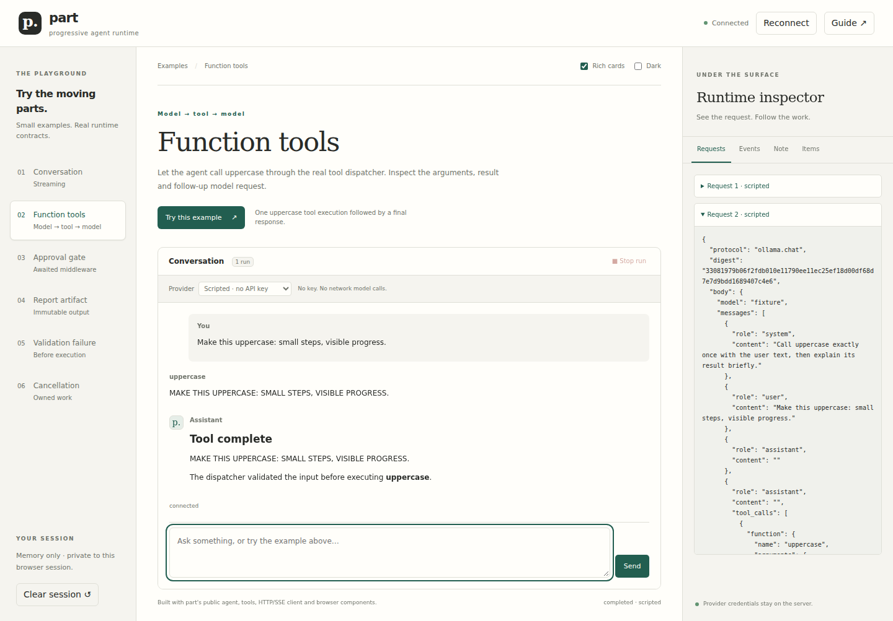

# Browser playground

The playground is a runnable example application built from part's public packages.
Choose a scenario, send a prompt, watch a real managed run, and inspect the encoded
requests and tool results beside the conversation. Its example-workspace organization
is inspired by [edaitor](https://github.com/slop-lab/edaitor); it does not depend on
edaitor or require an editor framework.



## Start

```sh
npm ci
npm run preview
```

Open **http://127.0.0.1:4173**. `npm run preview` builds the packages and browser
assets, then starts a loopback Node server. It does not open a browser automatically.
No provider account or Chromium installation is needed to use the playground in
your own browser. Stop the server with Ctrl+C. To choose another port:

```sh
PART_PREVIEW_PORT=4174 npm run preview
```

The default **Scripted** provider makes no upstream model requests. It uses the
portable fake model and Ollama encoder/decoder, with a small delivery delay to make
progress visible. The agent, context compiler, tool dispatcher, awaited middleware,
artifact store, HTTP/SSE transport, client controller and browser components all run.
It is not a screenshot or a timer that paints a simulated tool result.

`npm run preview:build` checks the browser example's TypeScript and generates
`preview/index.html`, `app.js` and `styles.css`. These assets need the local server's
API; opening the HTML directly or using a static-only server is not sufficient.
Restart `npm run preview` after changing source or environment settings. There is
no hot module replacement or external CDN/font requirement.

## Try the examples

Choose a scenario in the left sidebar. **Try this example** submits its suggested
prompt immediately. To customize it, edit the message box and choose **Send**.
The **Stop run** button cancels the currently active run. One run is admitted per
session at a time; selecting another example does not interrupt an active run.

| Example            | Actions                                                             | What to inspect                                                                                                |
| ------------------ | ------------------------------------------------------------------- | -------------------------------------------------------------------------------------------------------------- |
| Conversation       | Send the suggested prompt, then ask a follow-up                     | A streamed Markdown reply; the next request includes completed visible conversation turns                      |
| Function tools     | Submit the example and open both requests                           | `uppercase` arguments, one actual dispatcher execution, a tool result and a follow-up model request            |
| Approval gate      | Choose **Approve note write** or **Reject**                         | The write remains blocked while waiting; the Note tab changes only after approval; rejection executes no write |
| Report artifact    | Run the example, choose **Open report**, then **Load artifact**     | Finalized Markdown bytes, artifact metadata/digest and **Download**                                            |
| Validation failure | Run with Scripted, inspect Events, then compare with Function tools | A deliberately invalid argument is rejected before executor entry; tool-start count is zero                    |
| Cancellation       | Start the longer reply and press **Stop run**                       | Partial text, a terminal cancelled state and owned cleanup                                                     |

The note and report are example data held in memory. `save_note` replaces the
session note; `create_report` fills a small Markdown template using its validated
text argument and finalizes it through the core artifact store. No example executes
a shell command or writes to repository files. The model may request a note write
from any scenario, but the approval middleware always gates `save_note`.

### Inspector and presentation

- **Requests** shows the latest run's exact encoded request bodies and their
  outgoing-body digests. The gateway's inspection event carries the same digest.
  Authentication headers and configured endpoint URLs are not included.
- **Events** shows request inspections, tool entry/results, dispatcher outcomes,
  approval decisions and terminal run state. Up to 64 events are retained per run.
- **Note** displays the session note independently from the conversation.
- **Items** embeds the public Inspector. Select a projected item to inspect its
  JSON. Reports use the authorized artifact reader and explicit Load artifact action.
- **Rich cards** switches approval/report renderers to the generic fallback and
  back. Approval owner actions still work without the custom renderer. Changing
  renderers preserves the current composer draft and does not restart the run.
- **Dark** changes presentation only. The layout supports narrow screens; the
  scenario list scrolls horizontally on phones and the inspector moves below chat.
- **Guide** opens the in-browser guide. Inspector tabs support arrow keys, Home
  and End; the dialog closes with Escape. The composer retains its IME handling.

The inspector intentionally exposes this session's prompts and tool data for
experimentation. It is an explicit example projection, separate from the core
model gateway's default body/credential redaction policy.

### Session, refresh and cancellation

A browser-session cookie identifies a server-owned in-memory session. Refresh and
**Reconnect** bootstrap a new watch of its existing projected state and stream
parts. They do not resubmit a prompt. Closing the page or disconnecting observation
does not cancel work; use Stop or shut down the server. A separate browser context
gets a separate session; tabs sharing the cookie share conversation state.

Only completed visible user/assistant text is carried to subsequent runs, with the
last six turns retained per provider/model choice. Intra-run tool context remains
owned by the basic driver. This is a bounded example history, not the durable CAS
history API or a continuation/recovery implementation. Native model reasoning is
not added to this example's cross-run visible-text history. Refresh restores server
state but does not preserve an unsent browser draft or provider selection.

**Clear session** is available after the active run ends. It clears displayed runs,
conversation context, note and report access. Server restart clears all sessions.
The example permits 24 runs and 500 command IDs per session, and 16 browser sessions
per server process. Clearing does not forget command receipts; restart if those
capacity limits are reached. Late approvals against a closed run are rejected.

## Use R4U

Create or update the workspace-root `.env`:

```dotenv
R4U_API_KEY=your-project-key
R4U_BASE_URL=http://127.0.0.1:9470/v1
# Optional:
R4U_MODEL=gpt-6-luna
# R4U_ROUTE=your-route
```

Restart the playground, select **R4U · Responses** or **R4U · Chat Completions**,
and enter a model supported by the configured route. The validation-failure scenario
is intentionally Scripted-only. Other examples use their scenario instructions with
the selected real model; model compliance and results may vary.

Selecting a provider makes no model request. **Send** and **Try this example** do.
Each run permits at most four model invocations, four tool dispatches and three
minutes of execution, requesting at most 512 output tokens per invocation. Live fetches
have a 90-second timeout and no automatic retries. These controls are not a hard
provider billing cap. A configured option means credentials are present; it does
not certify route protocol support or model entitlement. Use `npm run smoke:provider`
or `npm run smoke:responses` to check that separately.

The server reads `.env` with Node's environment-file parser. The browser cannot
supply a provider endpoint or retrieve a key. Only the server builds authentication
headers and invokes the configured endpoint. `.env` is ignored by Git. Provider
failures expose structured codes and a generic message, not upstream error bodies.

The application binds to `127.0.0.1`, uses same-origin commands and an HttpOnly,
SameSite cookie, and proxies the public Node HTTP host through a server-only token.
It has no production user authentication or durable storage. Its loopback defaults
are intended for a personal local development environment.

## Extend the example

| File                               | Responsibility                                                                                 |
| ---------------------------------- | ---------------------------------------------------------------------------------------------- |
| `examples/playground/catalog.json` | Scenario names, instructions for users and suggested prompts                                   |
| `examples/playground/models.mjs`   | Delayed scripted replies and configured Chat/Responses transport                               |
| `examples/playground/runtime.mjs`  | Managed agents, validated tools, approval waits, public projection, history and command dedupe |
| `examples/playground/server.mjs`   | Static assets, per-session admission, same-origin boundary and public Node host proxy          |
| `examples/playground/main.ts`      | Public browser Chat/Inspector composition, controller, configuration and inspector tabs        |
| `examples/playground/renderers.ts` | Optional approval and report presentation plus owner-command helpers                           |
| `examples/playground/styles.css`   | Application layout and theme; SDK styles are included first                                    |
| `scripts/build-preview.mjs`        | Browser-only bundle and example type check                                                     |

To add a tool, install it with `functionTool` and supply its model JSON Schema.
Keep enforcement in the dispatcher/middleware, not in the renderer. To add a
scenario, extend the catalog and scripted replies plus the live scenario instruction.
To customize presentation, add a renderer with a safe fallback and send the same
owner command from both paths. The browser bundle excludes Node and provider plugins;
no provider credentials or execution implementation is bundled into the client.

## Validation

The normal `npm test` includes four playground runtime tests for command dedupe,
request/tool history, approve/reject/cancel, argument failure, artifact ownership,
clear and observer/shutdown semantics. Browser tests use only Scripted, even if your
workspace `.env` contains real credentials:

```sh
npx playwright install chromium
npm run test:browser
```

On Linux CI, use `npx playwright install --with-deps chromium`. To save screenshots:

```sh
PART_SCREENSHOTS=/tmp/part-playground-screenshots npm run test:browser
```

The Chromium suite exercises all six scenarios, renderer fallback approvals, report
loading/download, cancellation while streaming, reconnect, refresh, isolation,
composer draft preservation, server-only configuration and 390/768/1440-pixel layouts.
It starts its own ephemeral loopback server and closes it afterward. Browser binaries
are development tooling only and are never package runtime dependencies. CI configures
this check on Node 24; local success does not imply that hosted CI has run.

Local verification also exercised the real browser-to-server-to-R4U path: a Responses
conversation completed in one request, and a Chat Completions uppercase loop completed
in two requests with one tool execution. See [recorded evidence](playground.evidence.json).
The checked-in browser suite stays credential-free; live provider tests are explicit.
